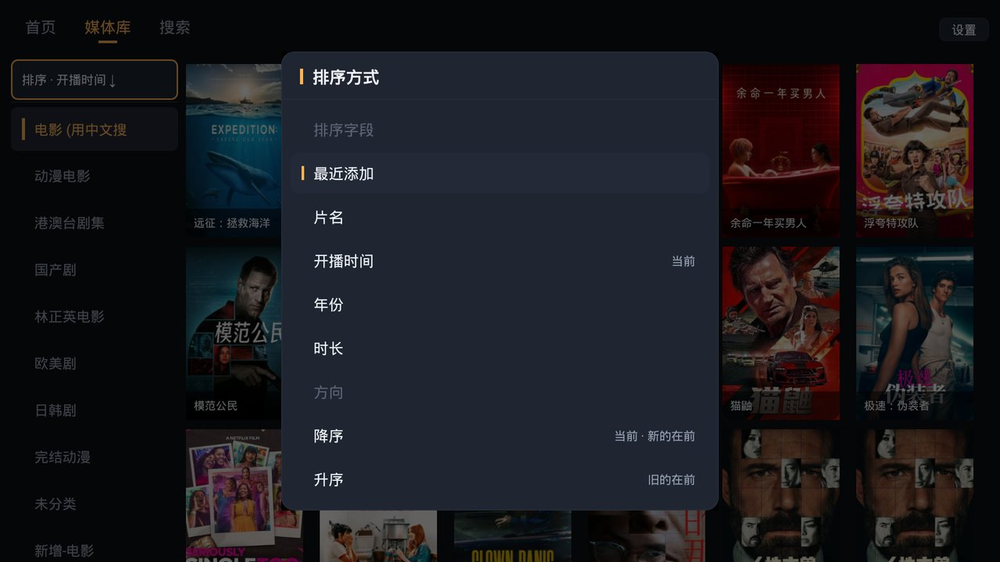

# MyEmbyHub

## 简介

给**十年前的智能电视**用的 Emby 客户端。

目标机器是一台乐视 S50 Air：**Android 4.3（API 18）**、1512MB 内存、应用堆上限 96MB、
没有 WebView、没有 GMS。这意味着 Compose、ExoPlayer 3、androidx.tv 全都用不了，
TLS 默认只开 1.0，证书链还认不得 Let's Encrypt 2024 的新根——所有东西都得自己手搓。

这个仓库就是那份手搓笔记 + 能跑的代码。

**最新版本**：[`v1.0.20261119.63`](https://github.com/MrLinda/MyEmbyHub/releases/latest) ——
电视上装一次带「在线更新」的版本，之后直接在电视里升级（走 GitHub Release，
自动尝试国内镜像前缀）。版本号形如 `1.0.20261117.2`，末位是「当天第几个版本」，
一天推几版不会撞号。

| 首页（顶栏 + 纵向横滑行） | 媒体库（左栏分类 + 海报墙） |
|---|---|
|  |  |

| 详情页（剧照背景 + 选集） | 排序（字段 + 方向两层） |
|---|---|
|  |  |

### 功能

- **首页**：顶部四个 tab（首页 / 媒体库 / 搜索 / 设置），内容是「继续观看 + 每个媒体库一行」的纵向横滑列表。
- **媒体库**：左侧竖排分类栏（14 个库一屏放不下，能滚），右侧海报墙，翻页自动加载。
- **详情页**：整页而不是弹窗——剧照做背景、海报、评分、类型、简介、技术信息、选集横条。
- **播放**：自写 `DataSource` 直连 Emby 取流，ExoPlayer 2.19.1（最后支持 API 18 的版本）解码。
- **搜索**：电视没有软键盘 → 走「手机扫码输入关键词」，电视起一个小 HTTP 服务，手机扫码即可。
- **排序**：字段（开播时间 / 最近添加 / 片名 / 年份 / 时长）× 方向（升 / 降），存盘。
- **在线更新**：GitHub Release 做源，三个国内镜像前缀自动兜底，下载支持**断点续传**。
- **设备反馈**：一键把系统版本、屏幕、内存、TLS 握手实测、解码器清单、最近一次播放的编码参数发到自建服务器（电视上没有 logcat，这是唯一能把现场带回来的路）。
- **扫码登录**：手机扫码把账号密码送进电视，不用在电视上打字。

### 电视上的焦点是这么设计的

| 行为 | 为什么 |
|---|---|
| 顶栏 tab **焦点一停就切页**（260ms 防抖） | 少按一次确认键；路过中间 tab 不算 |
| 首页每排 ↑ 回上一排**同序号**那张 | 不能交给框架：上一排滚出屏幕后不在 Attached 状态，框架找不到它，焦点会直接飞到顶栏 |
| 媒体库左栏 → 直接进海报墙第一张 | 左栏是「选分类」，选完就该看内容 |
| 详情页打开就落「播放」按钮 | 点开一部片十有八九是要接着看，不该让人先按方向键 |
| 从详情页返回，焦点回到**点进去的那张卡** | 记住了 `itemId`，回来按 id 找位置，找不到才退回第一张 |

## 安装

### 系统要求

| 项目 | 要求 |
|---|---|
| 系统版本 | **Android 4.3（API 18）起**。实测过的是 Android 4.3 真机和 API 18 模拟器 |
| 系统版本上限 | **Android 14（API 34）起装不上**：`targetSdk` 钉在 23，新系统会拒装 `targetSdk < 23` 的包 |
| CPU | `armeabi-v7a` 或 `x86`。只带这两个 ABI（省 4.6MB 原生库），**64 位专用设备跑不了** |
| 内存 | 实测 1512MB 物理内存、应用堆上限 96MB 的机器上正常。更低的内存档位没验过 |
| 存储 | 安装包 2.96MB，加上下载的更新包，留 100MB 富余 |
| 屏幕 | 电视实测 1920×1080 @ density 1.5（= 1280×720 dp）。界面按这个尺寸排版 |
| 服务端 | 标准 Emby，**不需要装任何插件**；「最近观看」等接口要 Emby 4.8+ |
| 服务器 TLS | **必须支持 TLS 1.1 以上**，TLS 1.0 会被拒握手 |
| 不需要 | WebView、GMS / Play 服务、Google 账号 |

> ⚠️ **Android 6.0（API 23）以上的设备，在线更新走不通**：`targetSdk` 停在 23 是为了保住
> `file://` 调安装器和直写 `/sdcard/Download` 这两条老路径，而运行时权限一直没做适配
> （代码里没有任何 `requestPermissions`）。所以新设备上「下载更新」会失败。
> 装在 4.3 上不受影响——那是目标设备，也是唯一实测过的环境。
>
> 想往上适配的话要改三处：加运行时权限申请、`Uri.fromFile` 换 `FileProvider`、
> 下载改走 `MediaStore.Downloads`（API 29+）。

### 装到电视

多数国产电视禁掉了 `adb root`，shell 用户没有 `INSTALL_PACKAGES` 权限，
`adb install` 会被 `SecurityException` 拒。可行路径是**调起系统安装器**：

```bash
adb push app-debug.apk /sdcard/Download/myembyhub.apk
adb shell am start --user 0 -a android.intent.action.VIEW \
  -d 'file:///sdcard/Download/myembyhub.apk' -t 'application/vnd.android.package-archive'
```

电视上需要人按一次「安装」。
（系统安装器装完会把源 APK 从 `/sdcard/Download/` 删掉——文件「凭空消失」是正常现象。）

### 在线更新

App 去拉 `version.json`，比对自己的 `versionCode`，有新版就下载 APK 并调起系统安装器。

```bash
# 本机联调：清单里指向局域网地址，起个支持 Range 的静态服务
python tools/serve-range.py 8765 dist
```

```json
{ "versionCode": 1794918005, "versionName": "1.0.20261117.2",
  "url": "http://192.168.1.50:8765/myembyhub-debug.apk", "size": 2174365, "notes": "…" }
```

正式发布走 GitHub Release（本仓库已经这么用了）：

```bash
# tag 不用写，脚本按 v + versionName 自己拼（v1.0.20261117.3）
pwsh tools/publish-release.ps1 -Repo MrLinda/MyEmbyHub -Notes "改了什么"
```

客户端取的是 `https://github.com/MrLinda/MyEmbyHub/releases/latest/download/version.json`
（`latest` 不带 tag，永远指向最新一个正式 Release），APK 同理。
脚本会校验「清单里的 versionCode」和「APK 里的 versionCode」一致再上传——
不一致直接中止，避免出现「装完还提示有新版本」的死循环。
细节见 [`docs/online-update.md`](docs/online-update.md)。

## 开发

### 构建

需要 **JDK 21+**（开发用的是 Android Studio 自带 JBR）。

```bash
# 正式 TV 客户端（产物在 app/build/outputs/apk/debug/）
./gradlew :app:assembleDebug

# 单元测试（UrlKit 的 URL / 重定向解析、更新镜像候选、版本比较）
./gradlew :app:testDebugUnitTest
```

> ⚠️ `assembleDebug` **只生成 `dist/version.json`，不会把 APK 拷进 `dist/`**。
> 发版请走 `tools/publish-release.ps1`，它会补这一步。
>
> ⚠️ `versionCode` 是**秒级时间戳**，所以**每跑一次 `assembleDebug` 就是一个新版本**。
> 调试期看到「一直提示有更新」通常就是这个原因，不是 bug（见 [`docs/online-update.md`](docs/online-update.md) 9.1）。

**在线更新地址**（写进 `dist/version.json` 的 `url`）按这个优先级取：

1. `-PupdateRepo=owner/repo` → 用 GitHub Release 的 `releases/latest/download/...`；
2. `-PupdateHost=host:port` → 用局域网 HTTP；
3. 本机 `local.properties` 里的 `updateRepo` / `updateHost`（**这个文件已 gitignore**）；
4. `app/build.gradle.kts` 里的默认值（占位符）。

### 模块

仓库只有一个模块：

| 模块 | 语言 | minSdk | 作用 |
|---|---|---|---|
| `app` | Kotlin + XML/Views | 18 | **正式 TV 客户端**：登录 / 首页 / 媒体库 / 详情 / 播放 / 搜索 / 排序 / 在线更新 |

UI 全部是 XML/Views——**Compose 要求 minSdk 21**，这台电视装不上。
焦点导航同理，`androidx.tv` / `tv-material` 也要 API 21，只能自己实现。

> 早期还有一个 `tvcheck`（TLS / 解码探针）和一个 `tvprobe`（设备自检）模块，
> 用来在没有真机反馈时做可行性验证。真机验证全部通过后它们就只剩历史价值了，
> 已删除；`tvcheck` 里唯一有长期价值的东西——`UrlKit` 的回归测试——
> 已经迁到 `app/src/test/`。

### 目录

```
app/                 正式客户端（app/src/test/ 是回归测试）
docs/                设备实测报告、界面与更新说明、截图
  home-screen.md     首页 / 媒体库 / 搜索三页的结构与焦点规则
  detail-screen.md   详情页
  online-update.md   在线更新（含「一直提示有更新」的三个成因）
  feedback.md        设备反馈：采集什么、为什么、上报协议
  tv-device-report.md  真机实测底细
tools/               辅助脚本
  publish-release.ps1  发版到 GitHub Release（含清单/APK 版本一致性校验）
  serve-range.py       支持 Range 的静态服务（ExoPlayer 取流要用）
dist/                交付产物（已 gitignore：里面是 APK 和带凭据的 conf）
AGENTS.md            ⚠️ 平台踩坑全集——改代码前先读
```

### 安全说明

- 仓库里**不含任何真实凭据**。`dist/`、本地 conf、`local.properties` 都在 `.gitignore` 里；
  文档里的服务器地址和局域网 IP 全是占位符。
- `app` 内置了三个 Let's Encrypt 根证书锚点（`assets/*.pem`），用于在没有新根的老系统上建立信任链。
- 登录密码只存在本机 `SharedPreferences`，不外发。
- 更新下载那条链路用了「信任所有证书」（`TrustMode.ALL`）：它不传任何凭据，
  而且下载完的 APK 还要过系统安装器的签名校验，所以这里不为了证书链再折腾一遍。

## 已知问题

分四类：只有第一类是我这台电视的硬件上限，第二类是客户端还没做，第三类看服务端，
第四类只跟模拟器有关 —— 换一台电视解决不了其中任何一条。

**这台电视解不了的**
- **4K HEVC 放不出画面**：MStar 的 HEVC 硬解上限是 1080p，4K 片源只有声音没有画面。
  客户端不锁分辨率（不设任何尺寸上限，4K 原样交给解码器），判到硬解吃不消时会在屏幕上说清原因。
  1080p 的 H.264 / HEVC 是这台机器的舒适区。

**客户端还没做的**
- 详情页没有演职人员、相似推荐。
- 字幕只有开 / 关，不能在多条内嵌字幕轨之间挑（菜单里会显示这部片子有几条轨）。
- HLS 没单独验证过（媒体库主体是 mkv / mp4 直放）。

**要看服务端的**
- 「最近观看」等接口要 Emby 4.8+ 的返回结构。

**只在模拟器上成立的**
- **4.3 的模拟器（API 18 / x86 镜像）播不了**：那套镜像里只有 `OMX.google.h264.decoder`，
  而且只吃 Baseline profile，没有 HEVC / AV1 —— 2013 年的 AOSP 里就没有这些东西，
  不是客户端的问题。所以「模拟器里黑屏」不代表有 bug。
- 新一点的模拟器（API 21 起 AOSP 才带软件 HEVC 解码器）能装上也能解 HEVC，
  但那是**软解**，不是电视上的 MStar 硬解 —— 丢帧数、起播耗时、4K 表现都不能当真。
  验 UI / 焦点 / 取数用 API 18 镜像；验播放规格只能上电视。
- 装不上新系统模拟器是另一回事：`targetSdk` 钉在 23，Android 14（API 34）起直接拒装
  （见[系统要求](#系统要求)）。

## License

MIT
