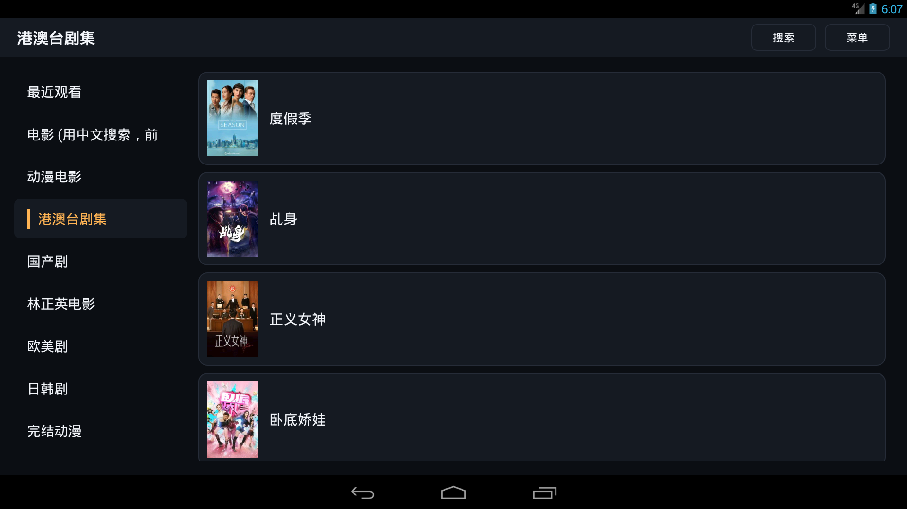
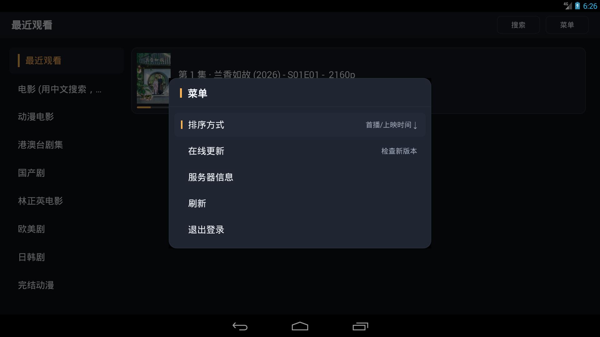
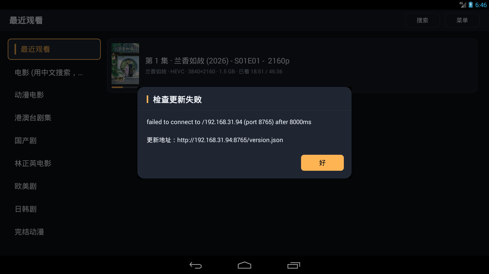

# MyEmbyHub

给**十年前的智能电视**用的 Emby 客户端。

目标机器是一台乐视 S50 Air：**Android 4.3（API 18）**、1512MB 内存、没有 WebView、没有 GMS。
这意味着 Compose、ExoPlayer 3、androidx.tv 全都用不了，TLS 默认只开 1.0，证书链还认不得
Let's Encrypt 2024 新根——所有东西都得自己手搓。

这个仓库就是那份手搓笔记 + 能跑的代码。

| 媒体库（纯文字类别栏 + 海报内容区） | 遥控器菜单 | 自绘对话框 |
|---|---|---|
|  |  |  |

---

## 特性

- **媒体库浏览**：左侧类别栏（纯文字，不请求封面）+ 右侧内容区（海报 + 进度条），支持多级下钻到剧集。
- **播放**：自写 `DataSource` 直连 Emby 取流，ExoPlayer 2.19.1（最后支持 API 18 的版本）解码。
- **搜索**：电视没有软键盘 → 走「手机扫码输入关键词」，电视起一个小 HTTP 服务，手机扫码即可。
- **排序**：按名称 / 加入时间 / 首播时间 / 年份 / 时长，升序降序。
- **在线更新**：App 自己比对 `version.json` 的 `versionCode`，有新版就在电视上下载并调起系统安装器。
- **扫码登录**：手机扫码把账号密码送进电视，不用在电视上打字。

---

## 这个项目有意思的地方

老设备适配的坑基本都踩了一遍，都记在 [`AGENTS.md`](AGENTS.md) 里。挑几个：

### TLS：4.3 只开 TLS 1.0 + 认不得 2024 年的根证书

系统 JSSE 默认只启用 TLS 1.0，且 CA 库停留在 2013 年。
`TlsStack` 包一层 `SSLSocketFactory` 把协议抬到 1.2（**只包 factory，不包 socket**——
包了 socket 却不转发 `connect()`，握手会以 `Broken pipe` 失败），
`BundledCa` 把 ISRG Root X1 / YR2 打进 `assets/` 手写逐级验签（不依赖 KeyStore，老系统上 KeyStore 类型支持参差不齐）。

> 实测：4.3 用系统 JSSE + 内置锚点，TLS 1.2 握手成功，**不需要 Conscrypt，也不需要 Bouncy Castle**。

### SNI：接口正常、取流全挂的经典坑

`SSLSocketFactory.createSocket()` 建出来的 socket **ClientHello 里没有 SNI**。
普通后端不 care，但源站一旦挂在 **Cloudflare** 前面，**没有 SNI 就直接拒握手**。

最迷惑的是：`HttpsURLConnection`（业务接口那条路）**自带 SNI**，
所以**接口调用全部正常，只有自写 `DataSource` 取流挂**，
错误还长得像「证书不对 / 服务器只支持 TLS 1.3 / 代理拦截」。

修法在 `TlsStack.applyServerName()`：API 24+ 用 `SSLParameters.setServerNames`；
**API 18** 只能反射调 `OpenSSLSocketImpl.setHostname(String)` 这个隐藏方法
（`SNIHostName` 那个类在 4.3 上根本不存在）。

### 取流：服务器 302 到另一个域名，而且节点会变

Emby 前面挂反代，取流会 302 到纯文件后端（另一个域名，多节点，**域名会变**）。
ExoPlayer 不跟重定向 → 自写 `DataSource` 读 `Location`、重建连接、重发请求。
两个坑：

- `java.net.URL(URL, String)` 在 4.3 的 libcore 上会把 base 的 query 重复拼到绝对 URL 后面 → 404
  → 自己写 `UrlKit.parse` / `UrlKit.resolve`（有单元测试兜底）；
- 逐字节读完 `\r\n\r\n` 后**不要 unread**，否则 ExoPlayer 收到的第一个字节是 `0D 0A` 而不是 `ftyp`
  → 十五个 extractor 全拒绝 → `PARSING_CONTAINER_UNSUPPORTED`。

### 焦点 ≠ 选中

电视上「焦点框」表示遥控器走到哪儿，「选中」表示右边内容来自哪一项，**两者必须能同时出现**。
于是左栏选中项 = 暖色竖条 + 暖色标题 + 浅底色，焦点框是另一个维度。

### RecyclerView 的两个暗坑

- **回收池按 `viewType` 分桶**：左右两列布局不同却共用一个池、且 viewType 都是 0
  → 右栏带海报的 holder 被左栏回收走，左栏渲染出带封面的卡片，还白白发一堆图片请求。
  → `getItemViewType() = side` 分桶。
- **视图缓存复用不重新绑定**：`setItemViewCacheSize(12)` 让滚出屏幕的 holder 进缓存，
  再滚回来时 **stable id 相同就直接复用，连 `onBindViewHolder` 都不调用**
  → holder 上残留的「选中」样式被带回来 → 左栏同时好几个 tab 高亮。
  → `onViewAttachedToWindow` 里按当前状态重刷视觉。

### 别的

- 4.3 的 `java.net.Socket` **没有实现 `Closeable`** → Kotlin 的 `socket.use {}` 真机上抛 `ClassCastException`（桌面 JVM 单元测试全绿）→ 一律手写 try/finally。
- `DisplayMetrics.densityDpi`、`Build.SERIAL` 等在老系统上访问会抛 `NoSuchFieldError` → 一律反射。
- `Thread.sleep()` 一定要接住 `InterruptedException`：从 `Runnable` 逃出去会被 `ThreadPoolExecutor`
  包成 `java.lang.Error` 抛到线程外 → **整个进程崩掉**。
- zxing 必须用 **3.2.1**：3.3.0+ 引用了 API 19 才有的 `StandardCharsets` → 4.3 上 `NoClassDefFoundError`。

---

## 构建

需要 **JDK 21+**（开发用的是 Android Studio 自带 JBR）。

```bash
# 正式 TV 客户端（产物在 app/build/outputs/apk/debug/）
./gradlew :app:assembleDebug

# 单元测试（目前只有 UrlKit 的 URL / 重定向解析回归测试）
./gradlew :app:testDebugUnitTest
```

> ⚠️ `assembleDebug` **只生成 `dist/version.json`，不会把 APK 拷进 `dist/`**，
> 打包后要手动同步，否则电视在线更新会下载到旧包。
>
> ⚠️ `versionCode` 是**秒级时间戳**，永远递增才能覆盖安装。
>
> **在线更新地址**（写进 `dist/version.json` 的 `url`）按这个优先级取：
> ① `-PupdateHost=host:port` 命令行参数 →
> ② 本机 `local.properties` 里的 `updateHost=host:port`（**这个文件已 gitignore**，
> 所以你本机的真实 IP 不会进仓库，仓库里只有占位符）→
> ③ `app/build.gradle.kts` 里的默认值 `192.168.1.50:8765`（占位符）。

---

## 装到电视

多数国产电视禁掉了 `adb root`，shell 用户没有 `INSTALL_PACKAGES` 权限，
`adb install` 会被 `SecurityException` 拒。可行路径是**调起系统安装器**：

```bash
adb push app-debug.apk /sdcard/Download/myembyhub.apk
adb shell am start --user 0 -a android.intent.action.VIEW \
  -d 'file:///sdcard/Download/myembyhub.apk' -t 'application/vnd.android.package-archive'
```

电视上需要人按一次「安装」。
（系统安装器装完会把源 APK 从 `/sdcard/Download/` 删掉——文件「凭空消失」是正常现象。）

### 在线更新

电视上的 App 会去拉 `version.json`：

```bash
cd dist && python -m http.server 8765 --bind 0.0.0.0
```

`dist/version.json` 由构建脚本生成，形如：

```json
{ "versionCode": 1794207018, "versionName": "1.0.20261109-145018",
  "url": "http://192.168.1.50:8765/myembyhub-debug.apk", "size": 2092453, "notes": "…" }
```

App 比对自己的 `versionCode`，有新版就下载 APK 并调起系统安装器。

---

## 模块

仓库只有一个模块：

| 模块 | 语言 | minSdk | 作用 |
|---|---|---|---|
| `app` | Kotlin + XML/Views | 18 | **正式 TV 客户端**：登录 / 媒体库 / 播放 / 搜索 / 排序 / 在线更新 |

UI 全部是 XML/Views——**Compose 要求 minSdk 21**，这台电视装不上。
焦点导航同理，`androidx.tv` / `tv-material` 也要 API 21，只能自己实现。

> 早期还有一个 `tvcheck`（TLS / 解码探针）和一个 `tvprobe`（设备自检）模块，
> 用来在没有真机反馈时做可行性验证。真机验证全部通过后它们就只剩历史价值了，
> 已删除；`tvcheck` 里唯一有长期价值的东西——`UrlKit` 的回归测试——
> 已经迁到 `app/src/test/`。

---

## 目录

```
app/                 正式客户端（app/src/test/ 是 UrlKit 的回归测试）
docs/                设备实测报告、交接文档、截图
tools/               辅助脚本（serve-dist.ps1 把 dist/ 发出去给电视在线更新）
dist/                交付产物（已 gitignore：里面是 APK 和带凭据的 conf）
AGENTS.md            ⚠️ 平台踩坑全集——改代码前先读
```

---

## 已知限制

- 播放默认锁 **1080p**：4K HEVC 解码器能初始化但起播慢，在 1GHz 的 MStar 上体验很差。
- HLS 未单独验证（媒体库主体是 mkv/mp4 直放）。
- 「最近观看」等接口依赖 Emby 4.8+ 的返回结构。

---

## 关于包名

包名是 `work.luxiaoxiao.myembyhub`（域名反写，按你自己的域名改）。

**要改包名的话，有四处必须同步改**（漏一处就出事）：

1. `app/build.gradle.kts` 的 `namespace` + `applicationId`；
2. 源码目录结构 + 所有 `package` 声明和 `import`；
3. ⚠️ **`app/proguard-rules.pro` 里的 `-keep class ...BuildConfig`** ——
   这是最容易漏的：keep 规则写的是旧包名 → 新的 `BuildConfig` 根本没被 keep
   → R8 优化掉 `VERSION_NAME` 字段 → `NoSuchFieldException`
   → 「服务器信息」里客户端版本显示为空、**在线更新永远提示「有新版」**；
4. `tools/*.ps1` 里的 `am start -n <包名>/.ui.LibraryActivity`。

另外注意：**改 `applicationId` 等于换了一个新应用** ——
电视上不能覆盖安装旧的（两个可以并存），而且 SharedPreferences 按包名隔离，
**登录态会丢一次**，要重新扫码登录。

---

## 安全说明

- 仓库里**不含任何真实凭据**。`dist/`、本地 conf、`local.properties` 都在 `.gitignore` 里。
- `app` 内置了三个 Let's Encrypt 根证书锚点（`assets/*.pem`），用于在没有新根的老系统上建立信任链。
- 登录密码只存在本机 `SharedPreferences`，不外发。

## License

MIT
