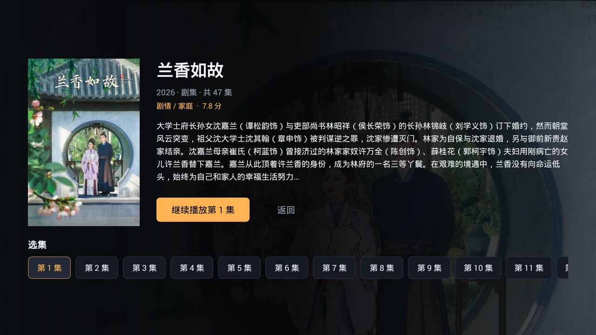

# MyEmbyHub

给**十年前的智能电视**用的 Emby 客户端。

目标机器是一台乐视 S50 Air：**Android 4.3（API 18）**、1512MB 内存、应用堆上限 96MB、
没有 WebView、没有 GMS。这意味着 Compose、ExoPlayer 3、androidx.tv 全都用不了，
TLS 默认只开 1.0，证书链还认不得 Let's Encrypt 2024 的新根——所有东西都得自己手搓。

这个仓库就是那份手搓笔记 + 能跑的代码。

**最新版本**：[`v1.0.20261117`](https://github.com/MrLinda/MyEmbyHub/releases/latest) ——
电视上装一次带「在线更新」的版本，之后直接在电视里升级（走 GitHub Release，
自动尝试国内镜像前缀）。

| 首页（顶栏 + 纵向横滑行） | 媒体库（左栏分类 + 海报墙） |
|---|---|
|  |  |

| 详情页（剧照背景 + 选集） | 排序（字段 + 方向两层） |
|---|---|
|  |  |

---

## 特性

- **首页**：顶部四个 tab（首页 / 媒体库 / 搜索 / 设置），内容是「继续观看 + 每个媒体库一行」的纵向横滑列表。
- **媒体库**：左侧竖排分类栏（14 个库一屏放不下，能滚），右侧海报墙，翻页自动加载。
- **详情页**：整页而不是弹窗——剧照做背景、海报、评分、类型、简介、技术信息、选集横条。
- **播放**：自写 `DataSource` 直连 Emby 取流，ExoPlayer 2.19.1（最后支持 API 18 的版本）解码。
- **搜索**：电视没有软键盘 → 走「手机扫码输入关键词」，电视起一个小 HTTP 服务，手机扫码即可。
- **排序**：字段（开播时间 / 最近添加 / 片名 / 年份 / 时长）× 方向（升 / 降），存盘。
- **在线更新**：GitHub Release 做源，三个国内镜像前缀自动兜底，下载支持**断点续传**。
- **扫码登录**：手机扫码把账号密码送进电视，不用在电视上打字。

### 电视上的焦点是这么设计的

| 行为 | 为什么 |
|---|---|
| 顶栏 tab **焦点一停就切页**（260ms 防抖） | 少按一次确认键；路过中间 tab 不算 |
| 首页每排 ↑ 回上一排**同序号**那张 | 不能交给框架：上一排滚出屏幕后不在 Attached 状态，框架找不到它，焦点会直接飞到顶栏 |
| 媒体库左栏 → 直接进海报墙第一张 | 左栏是「选分类」，选完就该看内容 |
| 详情页打开就落「播放」按钮 | 点开一部片十有八九是要接着看，不该让人先按方向键 |
| 从详情页返回，焦点回到**点进去的那张卡** | 记住了 `itemId`，回来按 id 找位置，找不到才退回第一张 |

---

## 这个项目有意思的地方

老设备适配的坑基本都踩了一遍，都记在 [`AGENTS.md`](AGENTS.md) 里。挑几个：

### TLS：4.3 只开 TLS 1.0 + 认不得 2024 年的根证书

系统 JSSE 默认只启用 TLS 1.0，且 CA 库停留在 2013 年。
`TlsStack` 包一层 `SSLSocketFactory` 把协议抬到 1.2（**只包 factory，不包 socket**——
包了 socket 却不转发 `connect()`，握手会以 `Broken pipe` 失败），
`BundledCa` 把 ISRG Root X1 / YR2 打进 `assets/` 手写逐级验签（不依赖 KeyStore，老系统上 KeyStore 类型支持参差不齐）。

> 实测：4.3 用系统 JSSE + 内置锚点，TLS 1.2 握手成功，**不需要 Conscrypt，也不需要 Bouncy Castle**。

### SNI：接口正常、取流全挂的经典坑

`SSLSocketFactory.createSocket()` 建出来的 socket **ClientHello 里没有 SNI**。
普通后端不 care，但源站一旦挂在 **Cloudflare** 前面，**没有 SNI 就直接拒握手**。

最迷惑的是：`HttpsURLConnection`（业务接口那条路）**自带 SNI**，
所以**接口调用全部正常，只有自写 `DataSource` 取流挂**，
错误还长得像「证书不对 / 服务器只支持 TLS 1.3 / 代理拦截」。

修法在 `TlsStack.applyServerName()`：API 24+ 用 `SSLParameters.setServerNames`；
**API 18** 只能反射调 `OpenSSLSocketImpl.setHostname(String)` 这个隐藏方法
（`SNIHostName` 那个类在 4.3 上根本不存在）。

### 取流：服务器 302 到另一个域名，而且节点会变

Emby 前面挂反代，取流会 302 到纯文件后端（另一个域名，多节点，**域名会变**）。
ExoPlayer 不跟重定向 → 自写 `DataSource` 读 `Location`、重建连接、重发请求。
两个坑：

- `java.net.URL(URL, String)` 在 4.3 的 libcore 上会把 base 的 query 重复拼到绝对 URL 后面 → 404
  → 自己写 `UrlKit.parse` / `UrlKit.resolve`（有单元测试兜底）；
- 逐字节读完 `\r\n\r\n` 后**不要 unread**，否则 ExoPlayer 收到的第一个字节是 `0D 0A` 而不是 `ftyp`
  → 十五个 extractor 全拒绝 → `PARSING_CONTAINER_UNSUPPORTED`。

### ScrollView 不把 paddingTop 当可视边界

首页是 `clipToPadding=false` + `paddingTop=76dp`（内容能滚到顶栏底下），
而 4.3 的 `ScrollView.computeScrollDeltaToGetChildRectOnScreen()` 里写的是
`final int screenTop = scrollY;` —— **它不看 paddingTop**。
于是焦点回到第一排时只滚到「第一排顶边压在 y=0」就停手，上半张卡藏在顶栏后面。

修法是继承 `ScrollView` 重写那个方法，把上边界下移 `paddingTop`（`TopInsetScrollView`）。
⚠️ 必须**自己重算 delta**，不能「调 super 再把结果平移」——整体平移会连下边界一起挪，
贴在屏幕下沿、只被切掉一点的焦点项反而不滚了。

同一个类里还要 `override fun executeKeyEvent() = false`：`ScrollView.dispatchKeyEvent`
是 `super.dispatchKeyEvent(event) || executeKeyEvent(event)`，卡片没消费的方向键
会让外层再 `arrowScroll` 一次，把手动 `scrollTo(0, 0)` 的复位冲掉。

### 焦点 ≠ 选中

电视上「焦点框」表示遥控器走到哪儿，「选中」表示右边内容来自哪一项，**两者必须能同时出现**。
所以左栏选中项 = 暖色竖条 + 暖色标题 + 浅底色，焦点框是另一个维度。

### 卡片焦点圈必须单独一层

`bg_card` 的 `state_focused` 描边画在卡片**背景**上，而海报 `ImageView` 是 `match_parent`
全铺的，把背景整个盖住 —— 遥控器走到哪张卡完全没有提示。
解法是叠一层 `bg_card_ring`（透明底 + 3dp 暖色描边），配 `duplicateParentState="true"`。

### RecyclerView 的两个暗坑

- **回收池按 `viewType` 分桶**：左右两列布局不同却共用一个池、且 viewType 都是 0
  → 右栏带海报的 holder 被左栏回收走，左栏渲染出带封面的卡片，还白白发一堆图片请求。
  → `getItemViewType() = side` 分桶。
- **视图缓存复用不重新绑定**：`setItemViewCacheSize(12)` 让滚出屏幕的 holder 进缓存，
  再滚回来时 **stable id 相同就直接复用，连 `onBindViewHolder` 都不调用**
  → holder 上残留的「选中」样式被带回来 → 左栏同时好几个 tab 高亮。
  → `onViewAttachedToWindow` 里按当前状态重刷视觉。

### 别的

- 4.3 的 `java.net.Socket` **没有实现 `Closeable`** → Kotlin 的 `socket.use {}` 真机上抛 `ClassCastException`（桌面 JVM 单元测试全绿）→ 一律手写 try/finally。
- `DisplayMetrics.densityDpi`、`Build.SERIAL` 等在老系统上访问会抛 `NoSuchFieldError` → 一律反射。
- `Thread.sleep()` 一定要接住 `InterruptedException`：从 `Runnable` 逃出去会被 `ThreadPoolExecutor`
  包成 `java.lang.Error` 抛到线程外 → **整个进程崩掉**。
- zxing 必须用 **3.2.1**：3.3.0+ 引用了 API 19 才有的 `StandardCharsets` → 4.3 上 `NoClassDefFoundError`。
- `ellipsize="end"` + `maxLines` 在 4.3 上不加省略号，硬切在半行字上 → 简介自己在代码里截断。

---

## 构建

需要 **JDK 21+**（开发用的是 Android Studio 自带 JBR）。

```bash
# 正式 TV 客户端（产物在 app/build/outputs/apk/debug/）
./gradlew :app:assembleDebug

# 单元测试（UrlKit 的 URL / 重定向解析、更新镜像候选、版本比较）
./gradlew :app:testDebugUnitTest
```

> ⚠️ `assembleDebug` **只生成 `dist/version.json`，不会把 APK 拷进 `dist/`**。
> 发版请走 `tools/publish-release.ps1`，它会补这一步。
>
> ⚠️ `versionCode` 是**秒级时间戳**，所以**每跑一次 `assembleDebug` 就是一个新版本**。
> 调试期看到「一直提示有更新」通常就是这个原因，不是 bug（见 [`docs/online-update.md`](docs/online-update.md) 9.1）。

**在线更新地址**（写进 `dist/version.json` 的 `url`）按这个优先级取：

1. `-PupdateRepo=owner/repo` → 用 GitHub Release 的 `releases/latest/download/...`；
2. `-PupdateHost=host:port` → 用局域网 HTTP；
3. 本机 `local.properties` 里的 `updateRepo` / `updateHost`（**这个文件已 gitignore**）；
4. `app/build.gradle.kts` 里的默认值（占位符）。

---

## 装到电视

多数国产电视禁掉了 `adb root`，shell 用户没有 `INSTALL_PACKAGES` 权限，
`adb install` 会被 `SecurityException` 拒。可行路径是**调起系统安装器**：

```bash
adb push app-debug.apk /sdcard/Download/myembyhub.apk
adb shell am start --user 0 -a android.intent.action.VIEW \
  -d 'file:///sdcard/Download/myembyhub.apk' -t 'application/vnd.android.package-archive'
```

电视上需要人按一次「安装」。
（系统安装器装完会把源 APK 从 `/sdcard/Download/` 删掉——文件「凭空消失」是正常现象。）

### 在线更新

App 去拉 `version.json`，比对自己的 `versionCode`，有新版就下载 APK 并调起系统安装器。

```bash
# 本机联调：清单里指向局域网地址，起个支持 Range 的静态服务
python tools/serve-range.py 8765 dist
```

```json
{ "versionCode": 1794913365, "versionName": "1.0.20261117-190245",
  "url": "http://192.168.1.50:8765/myembyhub-debug.apk", "size": 2174520, "notes": "…" }
```

正式发布走 GitHub Release（本仓库已经这么用了）：

```bash
pwsh tools/publish-release.ps1 -Repo MrLinda/MyEmbyHub -Tag v1.0 -Notes "改了什么"
```

客户端取的是 `https://github.com/MrLinda/MyEmbyHub/releases/latest/download/version.json`
（`latest` 不带 tag，永远指向最新一个正式 Release），APK 同理。
脚本会校验「清单里的 versionCode」和「APK 里的 versionCode」一致再上传——
不一致直接中止，避免出现「装完还提示有新版本」的死循环。
细节见 [`docs/online-update.md`](docs/online-update.md)。

---

## 模块

仓库只有一个模块：

| 模块 | 语言 | minSdk | 作用 |
|---|---|---|---|
| `app` | Kotlin + XML/Views | 18 | **正式 TV 客户端**：登录 / 首页 / 媒体库 / 详情 / 播放 / 搜索 / 排序 / 在线更新 |

UI 全部是 XML/Views——**Compose 要求 minSdk 21**，这台电视装不上。
焦点导航同理，`androidx.tv` / `tv-material` 也要 API 21，只能自己实现。

> 早期还有一个 `tvcheck`（TLS / 解码探针）和一个 `tvprobe`（设备自检）模块，
> 用来在没有真机反馈时做可行性验证。真机验证全部通过后它们就只剩历史价值了，
> 已删除；`tvcheck` 里唯一有长期价值的东西——`UrlKit` 的回归测试——
> 已经迁到 `app/src/test/`。

---

## 目录

```
app/                 正式客户端（app/src/test/ 是回归测试）
docs/                设备实测报告、界面与更新说明、截图
  home-screen.md     首页 / 媒体库 / 搜索三页的结构与焦点规则
  detail-screen.md   详情页
  online-update.md   在线更新（含「一直提示有更新」的三个成因）
  tv-device-report.md  真机实测底细
tools/               辅助脚本
  publish-release.ps1  发版到 GitHub Release（含清单/APK 版本一致性校验）
  serve-range.py       支持 Range 的静态服务（ExoPlayer 取流要用）
dist/                交付产物（已 gitignore：里面是 APK 和带凭据的 conf）
AGENTS.md            ⚠️ 平台踩坑全集——改代码前先读
```

---

## 已知限制

- 播放默认锁 **1080p**：4K HEVC 解码器能初始化但起播慢，在 1GHz 的 MStar 上体验很差。
- HLS 未单独验证（媒体库主体是 mkv/mp4 直放）。
- 「最近观看」等接口依赖 Emby 4.8+ 的返回结构。
- 详情页还没有演职人员、相似推荐、字幕轨切换。
- **模拟器上播不了**：x86 的 API 18 镜像只有 `OMX.google.h264.decoder`，且只吃 Baseline
  profile，没有 HEVC / AV1。所以「模拟器里黑屏」不代表客户端有 bug，
  播放和转码只能在真机上验。

---

## 关于包名

包名是 `work.luxiaoxiao.myembyhub`（域名反写，按你自己的域名改）。

**要改包名的话，有四处必须同步改**（漏一处就出事）：

1. `app/build.gradle.kts` 的 `namespace` + `applicationId`；
2. 源码目录结构 + 所有 `package` 声明和 `import`；
3. ⚠️ **`app/proguard-rules.pro` 里的 `-keep class ...BuildConfig`** ——
   这是最容易漏的：keep 规则写的是旧包名 → 新的 `BuildConfig` 根本没被 keep
   → R8 优化掉 `VERSION_NAME` 字段 → `NoSuchFieldException`
   → 「服务器信息」里客户端版本显示为空、**在线更新永远提示「有新版」**；
4. `tools/*.ps1` 里的 `am start -n <包名>/.ui.HomeActivity`。

另外注意：**改 `applicationId` 等于换了一个新应用** ——
电视上不能覆盖安装旧的（两个可以并存），而且 SharedPreferences 按包名隔离，
**登录态会丢一次**，要重新扫码登录。

---

## 安全说明

- 仓库里**不含任何真实凭据**。`dist/`、本地 conf、`local.properties` 都在 `.gitignore` 里；
  文档里的服务器地址和局域网 IP 全是占位符。
- `app` 内置了三个 Let's Encrypt 根证书锚点（`assets/*.pem`），用于在没有新根的老系统上建立信任链。
- 登录密码只存在本机 `SharedPreferences`，不外发。
- 更新下载那条链路用了「信任所有证书」（`TrustMode.ALL`）：它不传任何凭据，
  而且下载完的 APK 还要过系统安装器的签名校验，所以这里不为了证书链再折腾一遍。

## License

MIT
